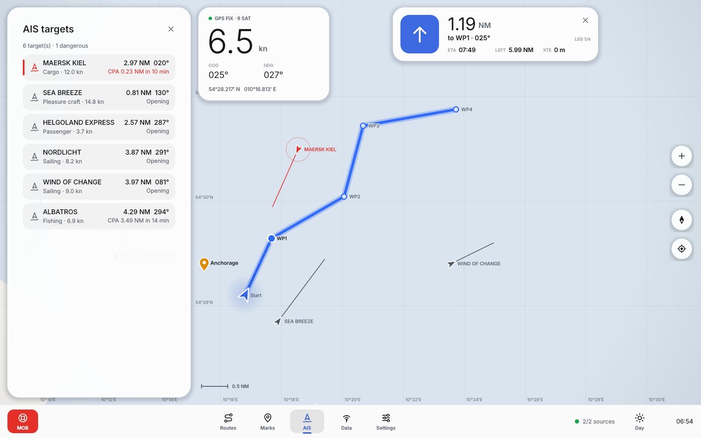

# OpenCPN Qt6 – neue Oberfläche

Dieses Verzeichnis enthält ein neues **Qt6-Frontend** für OpenCPN. Es ist ein
erster Schritt der Migration von wxWidgets nach Qt6. Gestaltet ist es nach dem
Vorbild aktueller Infotainmentsysteme von Tesla, NIO, Xpeng oder BYD:

* **Vollbildkarte** als zentrales Element, alles andere schwebt darüber
* **dunkle Glas-Panels** mit großen Radien und weichen Schatten
* **großer, leichter Tacho** (SOG) mit COG/HDG und Position
* **Navigationskarte** im „Turn-by-Turn“-Stil: Richtungspfeil, Distanz,
  ETA, Restweg und XTE
* **Dock am unteren Rand** mit den App-Bereichen und einer roten MOB-Taste
* **Seitenpanel**, das von links hereingleitet, für Routen, Markierungen,
  AIS, Datenquellen und Einstellungen
* **runde Kartenbuttons**: Zoom, North-up/Course-up und Schiff folgen
* **Nacht-, Tag- und Automatikmodus** (Wechsel um 07:00 und 19:00 Uhr)
* flüssige Bedienung: kinetisches Schwenken, animiertes Zoomen,
  Pinch-Gesten, interpoliert bewegtes Eigenschiff und Basiskarte, die im
  Hintergrund-Thread gerendert wird

| Nacht · aktive Route | Tag · AIS-Panel |
| --- | --- |
|  |  |

## Funktionsumfang (Phase 1)

| Bereich | Status |
| --- | --- |
| Vektor-Basiskarte (OpenCPN `data/basemap_shp`, 2 Detailstufen) | ✅ |
| Web-Mercator, North-up / Course-up, Gitternetz, Maßstab | ✅ |
| NMEA 0183: RMC, GGA, GLL, VTG, HDT, THS inkl. Checksumme | ✅ |
| AIS: Typen 1/2/3, 5, 18, 19, 24, mehrteilige Nachrichten | ✅ |
| CPA/TCPA, Kollisionsalarm mit pulsierender Markierung | ✅ |
| Datenquellen: UDP, TCP (Auto-Reconnect), seriell, Simulator | ✅ |
| Datenmonitor (Rohsätze) | ✅ |
| Routen auf der Karte zeichnen, aktivieren, Wegpunkte weiterschalten | ✅ |
| Markierungen, „Navigiere hierhin“, Mann über Bord | ✅ |
| GPX-Import/-Export (auch OpenCPN `navobj.xml`) | ✅ |
| Persistenz (GPX und QSettings) | ✅ |
| S-57/S-63-ENC, Rasterkarten (BSB/KAP), CM93 | ⏳ Phase 3 |
| Gezeiten/Strömungen, GRIB, Tracks aufzeichnen | ⏳ Phase 4 |
| Plugin-API | ⏳ Phase 5 |

## Bauen und Starten

Voraussetzungen: CMake ≥ 3.16, C++17-Compiler und Qt ≥ 6.4 mit den
Modulen Core, Gui, Widgets, Network, Svg und Concurrent. SerialPort ist
optional.

```bash
# Debian/Ubuntu
sudo apt install qt6-base-dev qt6-svg-dev libqt6serialport6-dev

cmake -S qt -B build-qt -DCMAKE_BUILD_TYPE=Release
cmake --build build-qt -j
./build-qt/opencpn-qt --demo        # startet mit Simulator und Demo-Route
(cd build-qt && ctest)              # Unit- und UI-Tests
```

Die Basiskarte wird automatisch im Quellbaum (`data/`) oder unter
`<prefix>/share/opencpn` gesucht. Alternativ lässt sich der Pfad mit
`OPENCPN_DATA_DIR` setzen.

Nützliche Optionen:

| Option | Wirkung |
| --- | --- |
| `--demo` | legt eine Demo-Route an und aktiviert sie |
| `--day` | startet im Tagmodus |
| `--page N` | öffnet das Seitenpanel (0 Routen … 4 Einstellungen) |
| `--fresh` | nutzt temporäre Einstellungen und Daten; die echte Konfiguration bleibt unberührt |
| `--screenshot datei.png [--size 1600x1000] [--delay ms]` | speichert einen Screenshot und beendet das Programm, auch mit `QT_QPA_PLATFORM=offscreen` |

Tastatur: `+`/`-` zoomen, `F` folgt dem Schiff, `F11` schaltet Vollbild um,
`Esc` schließt das Panel bzw. bricht die Routeneingabe ab, `Backspace`
entfernt den letzten Routenpunkt. Ein Rechtsklick auf die Karte öffnet das
Kontextmenü.

Standardmäßig sind der Simulator und UDP-Port 10110 (NMEA-Standardport)
aktiv. Ein Plotter oder ein Gateway, etwa Yacht Devices oder ein
SignalK-Server mit NMEA-0183-Ausgang, lässt sich unter **Daten**
hinzufügen.

## Architektur

```
qt/
├── src/core/        UI-unabhängig (nur QtCore/QtGui/QtNetwork)
│   ├── GeoMath      Mercator, Großkreis, XTE, CPA/TCPA
│   ├── Nmea, Ais    Parser + AIS-Decoder (Simulator enthält Encoder)
│   ├── NavStore     zentrales Modell: Eigenschiff, Routen, Wegpunkte,
│   │                AIS, Zielführung, Alarme (Signale für die UI)
│   ├── Connections  UDP/TCP/Seriell/Simulator → NmeaParser → NavStore
│   ├── GpxIO        GPX 1.1, kompatibel zu navobj.xml
│   ├── Shapefile    ESRI-Polygon-Reader für die Basiskarte
│   └── AppSettings  Einstellungen und Einheiten
├── src/ui/
│   ├── Theme        Design-Tokens (Nacht/Tag) und globales Stylesheet
│   ├── Icons        Linien-Icons als Inline-SVG, beliebig einfärbbar
│   ├── GlassPanel   Glas-Panel, RoundButton, DockButton, ToggleSwitch
│   ├── ChartView    Kartenansicht (asynchrones Land-Rendering, Gesten)
│   ├── Overlays     Tacho, Zielführung, Kartenbuttons, Dock, Toast …
│   ├── SideDrawer   animiertes Seitenpanel
│   ├── DrawerPages  Routen, Markierungen, AIS, Datenquellen, Einstellungen
│   └── MainWindow   Layout der schwebenden Elemente
└── tests/           QtTest: Core (NMEA/AIS/GPX/Geo) und UI-Smoke-Tests
```

Der Core enthält keinen Widget-Code. So kann er später ohne Änderungen
unter einer QML-/Qt-Quick-Oberfläche weiterverwendet werden, etwa für
Android oder Touch-Displays.

## Migrationsplan wxWidgets → Qt6

Der bestehende wx-Code umfasst rund 226 000 Zeilen in `gui/`, `model/` und
`libs/`; allein `chcanv.cpp` hat über 15 000 Zeilen. In fast 600 Dateien
wird wx direkt eingebunden. Eine Umstellung in einem Schritt ist weder
testbar noch reviewbar. Die Migration läuft deshalb parallel: Das
wx-Programm bleibt voll funktionsfähig, während das Qt-Frontend Stück für
Stück Funktionen übernimmt.

1. **Phase 1 – neue Oberfläche (dieser Stand).** Eigenständiges
   Qt6-Programm mit modernem Design, NMEA/AIS, Routen und GPX.
2. **Phase 2 – `model/` von wx entkoppeln.** `wxString` → `std::string`
   bzw. `QString` an den Grenzen, `wxDateTime` → `std::chrono`,
   `wxEvtHandler` → die vorhandene `libs/observable`-Infrastruktur. Danach
   kann das Qt-Frontend `model/` direkt nutzen, also Kommunikationstreiber
   (N2K, SignalK), Routenverwaltung, AIS-Decoder und Konfiguration.
3. **Phase 3 – Karten.** `libs/s52plib`, `libs/iso8211`, `libs/s57-charts`
   und die BSB-Reader auf ein dünnes Zeichen-Interface umstellen und in
   `ChartView` anbinden (QPainter/QRhi statt wxDC/wxGLCanvas).
4. **Phase 4 – Fachdialoge.** Gezeiten/Strömungen, Tracks, Ankeralarm und
   GRIB, jeweils als Seitenpanel-Seite im neuen Design.
5. **Phase 5 – Plugins.** Neue Qt-basierte Plugin-API. Für bestehende
   wx-Plugins wird ein Übergangsweg geprüft.
6. **Phase 6 – Umschaltung.** Das Qt-Programm wird zum Standard-Build, der
   wx-Build wird eingestellt.
